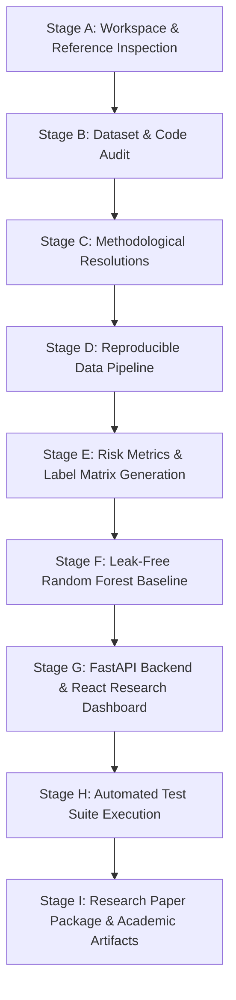

# Project Development & Implementation Plan

**Project Title:** Analysis of Portfolio Risk Across NIFTY Sectors During Macroeconomic Stress Events  
**Target Benchmark Dataset:** NiftyStress-44  
**Academic Affiliation:** Dayananda Sagar University | Major Project Phase-I (2026–2027)  
**Supervisor / Guide:** Prof. Yashpal Gupta S  
**Research Team:** Akshata I Kallimath, Basanagouda, Guru Kumar, Indushree D N  

---

## 1. Implementation Roadmap & Phases

The capstone project is organized into nine sequential, rigorous phases designed to meet both the faculty evaluation requirements and the conference submission standards for IEEE CIFEr / ACM ICAIF / Springer FinanceML.

---

## 2. Phase-by-Phase Breakdown

### Phase 1: Workspace Inspection & Reference Alignment (Stage A)
- **Status:** COMPLETED.
- **Key Deliverables:**
  - Full inspection of `Objective2_PortfolioDrawdown_Dataset (1).pdf` and `Zeroth_Review.pptx`.
  - Identification and clean extraction of `Nifty_50` archive into `original_project/`.
  - Cataloging all existing artifacts in `docs/PROJECT_INVENTORY.md`.
  - Comprehensive master execution plan in `docs/PROJECT_PLAN.md`.

### Phase 2: Comprehensive Dataset Audit & Diagnostics (Stage B)
- **Status:** IN PROGRESS.
- **Tasks:**
  - Audit structural completeness (11 sectors × 4 events = 44 records).
  - Verify data provenance, constituent tickers, and return calculations.
  - Audit calculation formulas (MDD, VaR 95%, Sharpe drop, recovery time).
  - Verify Nifty 50 stress window drawdowns against the 5% threshold.
  - Document all technical and methodological discrepancies.
- **Deliverables:**
  - `reports/dataset_audit_report.md`
  - `reports/data_provenance_report.md`
  - `reports/methodology_issues.md`
  - `reports/data_quality_summary.json`
  - `reports/dataset_schema_report.json`
  - `reports/repair_log.csv`
  - `reports/records_requiring_review.csv`
  - Explicit audit verdict (PASS / PASS WITH LIMITATIONS / FAIL).

### Phase 3: Methodological Correction & Architecture Design (Stage C)
- **Tasks:**
  - Formally resolve `sharpe_drop` calculation: implement 90-day pre-stress baseline lookback and excess return formulation.
  - Formally resolve `recovery_days`: implement dual tracking (window-censored per PDF rule and full empirical recovery days).
  - Enforce exact 9-column schema required by the official specification.
  - Establish directory structure: `data/`, `configs/`, `src/`, `frontend/`, `tests/`, `docs/`, `reports/`.

### Phase 4: Modular Reproducible Data Pipeline (Stage D)
- **Tasks:**
  - Ingestion module: fetch and clean OHLCV data for sector constituents (`src/data_ingestion/`).
  - Preprocessing module: trading calendar alignment, missing return imputation (`src/preprocessing/`).
  - Risk metric calculation engine (`src/risk_metrics/`):
    - `mdd_compute.py`
    - `var_compute.py`
    - `sharpe_drop.py`
    - `recovery_time.py`
  - Validation engine: check stress window boundary conditions (`src/validation/`).
- **Deliverables:**
  - Cleaned per-sector return series in `data/raw/sector_returns/`.
  - `configs/stress_windows_config.json` and `configs/sector_constituents.json`.
  - Offline mode support using verified local historical series.

### Phase 5: Risk Label Generation & Benchmark Release (Stage E)
- **Tasks:**
  - Authoritative rule-based label assignment (`src/labeling/label_assign.py`).
  - High Risk: MDD < -15%, Medium Risk: -15% ≤ MDD < -5%, Low Risk: MDD ≥ -5%.
  - Verification of boundary edge cases.
  - Generation of official outputs in `data/processed/`:
    - `NiftyStress44_final.csv`
    - `risk_label_matrix.xlsx`
    - `data_dictionary.xlsx`
    - `domain_validation_notes.xlsx`

### Phase 6: Leakage-Free Model Training & Small-Sample Evaluation (Stage F)
- **Tasks:**
  - Exclude MDD and any target-derived features from genuine predictive evaluation.
  - Handle the 44-record sample and 2 populated classes (26 High, 18 Medium).
  - Implement 3-Fold Stratified Cross-Validation per official specification.
  - Implement Leave-One-Stress-Event-Out (GroupKFold) cross-validation to assess temporal generalization across crisis windows.
  - Compute Accuracy, Balanced Accuracy, Precision, Recall, F1-score (Macro and per-class), and Confusion Matrix.
  - Save results to `data/processed/baseline_classifier_results.csv` and model artifacts in `artifacts/`.

### Phase 7: Full-Stack Interactive Research Dashboard (Stage G)
- **Backend (FastAPI)**:
  - Endpoints: `/api/health`, `/api/summary`, `/api/stress-events`, `/api/sectors`, `/api/risk-matrix`, `/api/records`, `/api/records/{sector}/{event_id}`, `/api/provenance`, `/api/model-results`, `/api/export/{format}`.
  - Robust error handling, typed Pydantic schemas, CORS configuration.
- **Frontend (React + TypeScript + Vite + Tailwind CSS / Recharts)**:
  - Quantitative finance research aesthetic (deep navy theme, teal accents, clean typography).
  - 9 fully functional interactive pages:
    1. Research Overview (KPI cards, dataset status, label distribution).
    2. Stress Event Explorer (event details, triggers, timeline, NIFTY 50 drawdowns).
    3. Sector Risk Heatmap (interactive 11×4 color-coded matrix with detailed modal inspection).
    4. Portfolio Risk Analytics (comparative charts for MDD, VaR 95%, recovery days, Sharpe drop).
    5. Dataset Explorer (searchable, filterable, sortable table with CSV/Excel export).
    6. Model Laboratory (features, leakage analysis, cross-validation metrics, confusion matrix).
    7. Data Quality & Provenance (audit findings, repair log, missing data transparency).
    8. Methodology & Documentation (mathematical formulas, threshold rules, academic citations).
    9. About the Research (capstone project info, team details, supervisor, reproducibility guide).

### Phase 8: Comprehensive Automated Testing (Stage H)
- **Tasks:**
  - Financial calculation tests (known MDD edge cases, flat prices, VaR percentile consistency, Sharpe drop signs, recovery calculation).
  - Data integrity tests (schema columns, data types, no duplicate sector-events, valid date ranges).
  - Model tests (zero target leakage verification, reproducible random seeds, proper metric computation).
  - API and UI integration tests (FastAPI test client, endpoint status codes, payload structure).
- **Execution & Reporting:** Run `pytest` and generate an execution report with 100% test pass rate.

### Phase 9: Research Paper Package & Academic Dissemination (Stage I)
- **Tasks:**
  - Prepare conference-ready documentation in `docs/`:
    - `RESEARCH_METHODOLOGY.md`
    - `DATA_DICTIONARY.md`
    - `DATA_PROVENANCE.md`
    - `EXPERIMENT_PROTOCOL.md`
    - `LIMITATIONS.md`
    - `REPRODUCIBILITY.md`
    - `RELATED_WORK.md`
    - `PAPER_OUTLINE.md`
  - Generate high-resolution research figures and formatted LaTeX/Markdown tables in `reports/` and `artifacts/`.
  - Final review against capstone criteria and conference submission tracks (IEEE CIFEr, Springer FinanceML, ACM ICAIF).

---

## 3. Risk Management & Acceptance Criteria

| Risk Factor | Impact | Mitigation Strategy |
| :--- | :--- | :--- |
| Extreme class imbalance (0 Low records) | Model cannot evaluate 3 classes | Clearly document that all 4 macro stress events were market-wide crises causing >5% index drop, meaning no sector experienced <5% drawdown. Frame classification as binary High vs. Medium risk or relative resilience. |
| Small sample size (N = 44) | High variance in random train/test splits | Employ Stratified 3-Fold Cross-Validation and Leave-One-Event-Out validation; report fold-wise variance honestly rather than claiming inflated accuracy. |
| Target leakage from MDD | Unsound academic claims | Explicitly separate rule-based threshold labeling from predictive classification; exclude MDD from feature set in genuine ML benchmarks. |
| Incomplete recovery within crisis window | 21 missing recovery days | Report both strict window-censored recovery (`NaN` per PDF spec) and empirical extended recovery days, documenting the financial rationale. |
