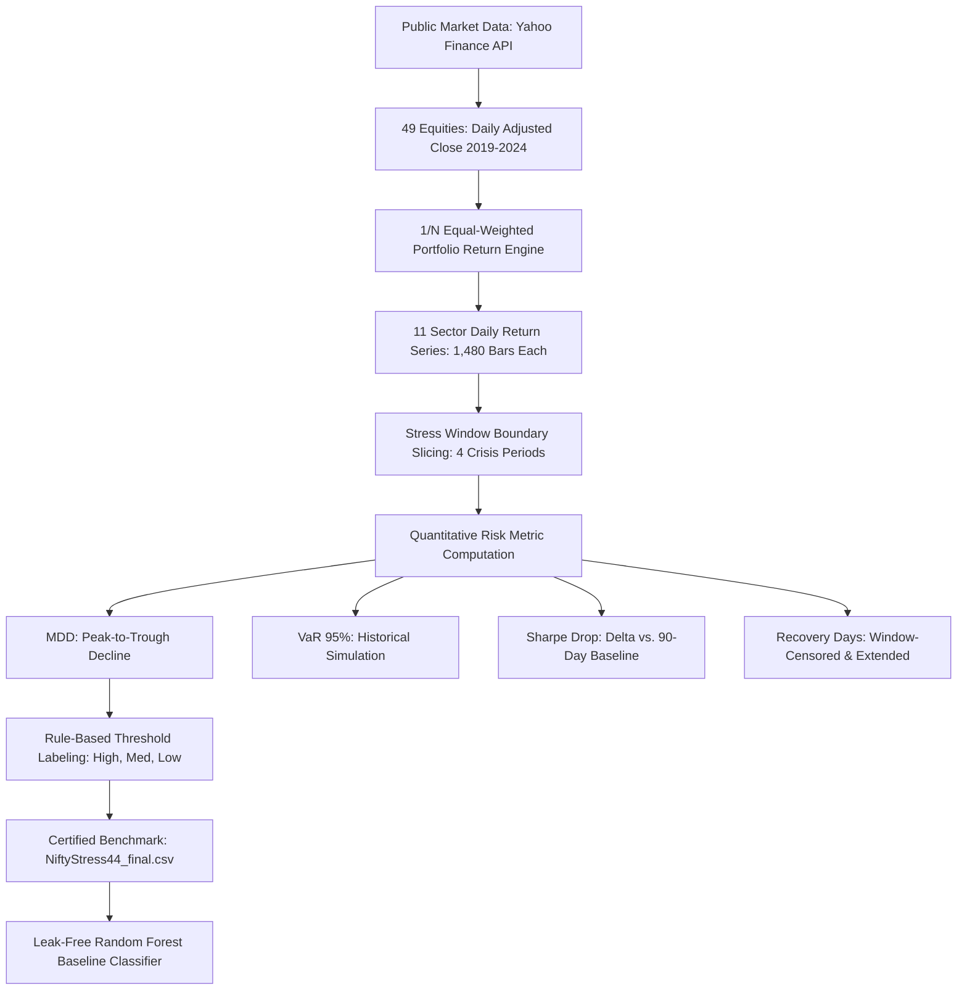

# Research Methodology

**Project Title:** Analysis of Portfolio Risk Across NIFTY Sectors During Macroeconomic Stress Events  
**Benchmark Dataset:** NiftyStress-44  
**Target Conferences:** IEEE CIFEr 2025 · Springer FinanceML · ACM ICAIF 2025  
**Institution:** Department of Computer Science and Engineering, School of Engineering, Dayananda Sagar University  
**Supervisor / Guide:** Prof. Yashpal Gupta S  
**Research Team (Team 27):** Akshata I Kallimath, Basanagouda, Guru Kumar, Indushree D N  

---

## 1. Problem Statement & Research Gap

Existing Indian equity market datasets (e.g., historical BSE/NSE price archives on Kaggle, Mendeley, and Yahoo Finance) focus almost exclusively on continuous normal trading periods. They do not isolate crisis windows or provide sector-level risk labels. Because financial asset dynamics exhibit non-linear volatility clustering, structural breaks, and liquidity freezes during macroeconomic stress, portfolio risk models calibrated on normal-period data systematically fail during crisis regimes.

Furthermore, empirical quantitative finance literature rarely integrates **Maximum Drawdown (MDD)**, **Value at Risk (VaR 95%)**, **Sharpe ratio drop**, and **recovery time** into a unified labeled benchmark. This project addresses this critical gap by constructing **NiftyStress-44**, a reproducible benchmark dataset covering 11 NSE sectors across four defined macroeconomic stress events (2020–2023).

---

## 2. Macroeconomic Stress Windows

Four macroeconomic stress events were identified and validated against market-wide drawdowns in the benchmark index **NIFTY 50 (`^NSEI`)**. Each window captures a peak-to-trough decline exceeding 5%:

| Stress Event | Defined Start | Defined End | Macroeconomic Trigger | NIFTY 50 Peak Date | NIFTY 50 Trough Date | NIFTY 50 MDD (%) | Criterion (MDD ≤ -5%) |
| :--- | :--- | :--- | :--- | :--- | :--- | :--- | :--- |
| **COVID-19 Crash** | 2020-02-17 | 2020-04-01 | WHO pandemic declaration & nationwide lockdown | 2020-02-19 | 2020-03-23 | **-37.24%** | **PASS** |
| **Russia-Ukraine Shock** | 2022-02-16 | 2022-04-29 | Geopolitical invasion & commodity supply shock | 2022-02-16 | 2022-03-07 | **-8.42%** | **PASS** |
| **RBI Rate Hike Cycle** | 2022-05-04 | 2023-02-08 | RBI repo rate increases (4.0% → 6.5%) | 2022-05-05 | 2022-06-17 | **-8.33%** | **PASS** |
| **US Fed Tightening** | 2022-03-16 | 2023-12-13 | US Fed rate hikes (0.25% → 5.5%) & FII outflows | 2022-04-04 | 2022-06-17 | **-15.29%** | **PASS** |

---

## 3. Sector Portfolio Construction

Each of the 11 sectors is modeled as an equal-weighted ($1/N$) portfolio of 4 to 5 liquid, representative large-cap constituent stocks traded on the National Stock Exchange of India (NSE). Daily simple returns are calculated from split- and dividend-adjusted closing prices:
$$R_{s, t} = \frac{1}{K_s} \sum_{k=1}^{K_s} \frac{P_{s, k, t} - P_{s, k, t-1}}{P_{s, k, t-1}}$$
where $K_s$ is the number of constituent stocks in sector $s$.

---

## 4. Financial Risk Metrics Formulation

### 4.1 Maximum Drawdown (MDD)
Cumulative portfolio wealth starting from $W_0 = 1.0$ is:
$$W_t = \prod_{\tau=1}^t (1 + R_{s, \tau})$$
Running wealth maximum up to time $t$ is:
$$M_t = \max_{0 \le \tau \le t} W_\tau$$
Drawdown at time $t$ is:
$$DD_t = \frac{W_t - M_t}{M_t}$$
The Maximum Drawdown percentage within the stress window $[T_{start}, T_{end}]$ is:
$$MDD = \min_{t \in [T_{start}, T_{end}]} DD_t \times 100\%$$

### 4.2 Value at Risk (VaR 95%)
Using non-parametric historical simulation, VaR at the 95% confidence level is the 5th percentile of daily simple returns during the stress window:
$$VaR_{0.95} = F_R^{-1}(0.05) \times 100\%$$
Reported as a signed negative return quantile (e.g., -4.20%).

### 4.3 Sharpe Ratio Drop ($\Delta Sharpe$)
Annualized Sharpe ratio is defined as:
$$Sharpe = \frac{\mu - R_f}{\sigma} \sqrt{252}$$
The pre-stress baseline Sharpe ratio ($Sharpe_{base}$) is calculated over the 90 calendar days immediately preceding the stress window start date ($T_{start} - 90 \text{ days}$).
The Sharpe Drop is:
$$\Delta Sharpe = Sharpe_{stress} - Sharpe_{base}$$

### 4.4 Recovery Days
Let $t_{trough} = \arg\min_t DD_t$ be the trough date, and $W_{peak}$ be the preceding peak wealth.
Recovery time is the number of trading days elapsed until cumulative wealth recovers to $W_{peak}$:
$$t_{rec} = \min \{ t > t_{trough} : W_t \ge W_{peak} \}$$
$$\text{Recovery Days} = t_{rec} - t_{trough}$$
If $t_{rec} > T_{end}$, recovery days is censored and recorded as **NaN** per official specification.

---

## 5. Authoritative Risk Label Assignment

The ground-truth classification is assigned strictly via deterministic threshold rules on Maximum Drawdown:
$$\text{Risk Label} = \begin{cases} \text{High Risk} & \text{if } MDD < -15.0\% \\ \text{Medium Risk} & \text{if } -15.0\% \le MDD < -5.0\% \\ \text{Low Risk} & \text{if } MDD \ge -5.0\% \end{cases}$$

### Empirical Class Distribution:
- **High Risk:** 26 records (59.1%)
- **Medium Risk:** 18 records (40.9%)
- **Low Risk:** 0 records (0.0%)

**Methodological Finding:** Broad macroeconomic stress events that induce an index-level drawdown $\ge 5\%$ systemic loss inevitably drag all sector portfolios down by more than 5%. The minimum drawdown observed across all 44 records is -6.68% (FMCG during RBI Rate Hike Cycle). Hence, 0 records in Low Risk is an empirical finding of market contagion, not a data defect.
