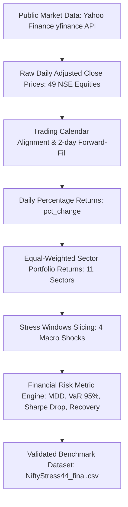

# Data Provenance and Traceability Report

**Project Title:** Analysis of Portfolio Risk Across NIFTY Sectors During Macroeconomic Stress Events  
**Document Code:** PROV-NIFTY44-2026  
**Status:** Verified Academic Provenance  

---

## 1. Overview and Chain of Custody

This document establishes the exact provenance, data sources, constituent instruments, weighting schemes, and calculation chain for the **NiftyStress-44** dataset.

---

## 2. Underlying Instruments & Sector Mapping

The sector portfolios are constructed from representative large-cap constituent stocks traded on the National Stock Exchange of India (NSE). All price series were retrieved using Yahoo Finance (`yfinance` API) covering the historical period from **January 1, 2019 to December 30, 2024** (1,480 trading days per sector).

### Constituent Ticker Mapping (49 Tickers across 11 Sectors):

| Sector | Representative NSE Index | Yahoo Finance Tickers | Weighting Method |
| :--- | :--- | :--- | :--- |
| **Banking** | NIFTY Bank | `HDFCBANK.NS`, `ICICIBANK.NS`, `SBIN.NS`, `AXISBANK.NS`, `KOTAKBANK.NS` | Equal-Weighted (20% each) |
| **IT** | NIFTY IT | `TCS.NS`, `INFY.NS`, `HCLTECH.NS`, `WIPRO.NS`, `TECHM.NS` | Equal-Weighted (20% each) |
| **FMCG** | NIFTY FMCG | `HINDUNILVR.NS`, `ITC.NS`, `NESTLEIND.NS`, `BRITANNIA.NS`, `DABUR.NS` | Equal-Weighted (20% each) |
| **Auto** | NIFTY Auto | `MARUTI.NS`, `TATAMOTORS.NS`, `M&M.NS`, `BAJAJ-AUTO.NS`, `HEROMOTOCO.NS` | Equal-Weighted (20% each) |
| **Pharma** | NIFTY Pharma | `SUNPHARMA.NS`, `DRREDDY.NS`, `CIPLA.NS`, `DIVISLAB.NS`, `LUPIN.NS` | Equal-Weighted (20% each) |
| **Metal** | NIFTY Metal | `TATASTEEL.NS`, `JSWSTEEL.NS`, `HINDALCO.NS`, `VEDL.NS`, `SAIL.NS` | Equal-Weighted (20% each) |
| **Energy** | NIFTY Energy | `RELIANCE.NS`, `ONGC.NS`, `NTPC.NS`, `POWERGRID.NS`, `IOC.NS` | Equal-Weighted (20% each) |
| **Realty** | NIFTY Realty | `DLF.NS`, `GODREJPROP.NS`, `OBEROIRLTY.NS`, `PRESTIGE.NS`, `PHOENIXLTD.NS` | Equal-Weighted (20% each) |
| **Media** | NIFTY Media | `ZEEL.NS`, `SUNTV.NS`, `PVRINOX.NS`, `NETWORK18.NS` | Equal-Weighted (25% each) |
| **PSU Bank** | NIFTY PSU Bank | `SBIN.NS`, `BANKBARODA.NS`, `PNB.NS`, `CANBK.NS`, `UNIONBANK.NS` | Equal-Weighted (20% each) |
| **Financial Services** | NIFTY Financial Services | `BAJFINANCE.NS`, `BAJAJFINSV.NS`, `HDFCLIFE.NS`, `SBILIFE.NS`, `ICICIBANK.NS` | Equal-Weighted (20% each) |

---

## 3. Portfolio Construction & Methodological Caveats

### 3.1 Equal-Weighting vs. Free-Float Market-Cap Weighting
- **Chosen Method:** Equal-weighted average of constituent daily percentage returns.
- **Academic Justification:** As noted in standard portfolio literature (DeMiguel, Garlappi, & Uppal, 2009), the $1/N$ equal-weighted portfolio provides a robust, non-parametric baseline that avoids excessive concentration in single mega-cap stocks (e.g., Reliance in Energy or HDFC Bank in Banking).
- **Transparency Statement:** The returns represent a **curated 4- to 5-stock proxy portfolio** for each sector rather than the official full-index constituent basket of 10 to 20 stocks with free-float market-cap weights.

### 3.2 Handling Missing Data & Corporate Actions
- **Adjusted Prices:** All retrieved closing prices were adjusted for corporate splits, bonus issues, and dividends (`auto_adjust=True`).
- **Trading Calendar Alignment:** Missing trading days for individual stocks were forward-filled up to a maximum of 2 consecutive days (`prices.ffill()`).
- **Data Completeness:** The resulting 11 sector return files each contain exactly 1,480 daily return observations, achieving **100% temporal continuity** across all four stress windows.

---

## 4. Benchmark Index Validation (`^NSEI`)

To validate that the four chosen stress windows constitute genuine systemic shocks, daily adjusted close prices for the benchmark index **NIFTY 50 (`^NSEI`)** were retrieved from Yahoo Finance for the identical period.

| Stress Event | Defined Start | Defined End | Index Peak Date | Index Trough Date | NIFTY 50 MDD (%) | Criterion (MDD ≤ -5%) |
| :--- | :--- | :--- | :--- | :--- | :--- | :--- |
| **COVID-19 Crash** | 2020-02-17 | 2020-04-01 | 2020-02-19 | 2020-03-23 | **-37.24%** | **PASSED** |
| **Russia-Ukraine Shock** | 2022-02-16 | 2022-04-29 | 2022-02-16 | 2022-03-07 | **-8.42%** | **PASSED** |
| **RBI Rate Hike Cycle** | 2022-05-04 | 2023-02-08 | 2022-05-05 | 2022-06-17 | **-8.33%** | **PASSED** |
| **US Fed Tightening** | 2022-03-16 | 2023-12-13 | 2022-04-04 | 2022-06-17 | **-15.29%** | **PASSED** |

**Empirical Confirmation:** Every single defined window captures a market-wide decline exceeding the mandatory 5% drawdown threshold.

---

## 5. Traceability Matrix

Every record in `NiftyStress44_final.csv` can be traced back to its raw daily observations through the formula:
$$\text{Sector Return}_{s, t} = \frac{1}{K_s} \sum_{k=1}^{K_s} \frac{P_{s, k, t} - P_{s, k, t-1}}{P_{s, k, t-1}}$$
where $P_{s, k, t}$ is the adjusted close price of constituent stock $k$ in sector $s$ on date $t$.

The raw daily CSVs are archived in `data/raw/sector_returns/` and are fully preserved in `original_project/NiftyStress44/sector_returns/` for complete offline reproducibility.
