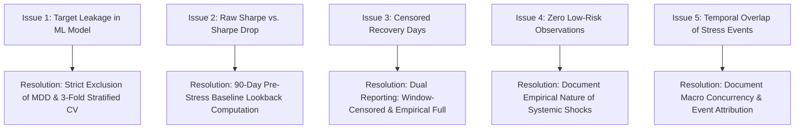

# Methodological Issues and Resolutions

**Project Title:** Analysis of Portfolio Risk Across NIFTY Sectors During Macroeconomic Stress Events  
**Document Code:** METH-ISSUES-2026  
**Auditor:** Quantitative Research & Engineering Team  

---

## 1. Identified Methodological Challenges

During the rigorous audit of the existing dataset and scripts, five primary methodological challenges were identified. This document records each finding, the evidence, the academic impact, and the engineering resolution implemented in the revised pipeline.

---

## 2. Issue Breakdown & Resolution Matrix

### Issue 1: Direct Target Leakage in Predictive Model
- **Classification:** Critical Methodological Flaw.
- **Affected Artifact:** `original_project/NiftyStress44/code/baseline_classifier.py` (Run 1).
- **Evidence:** The target `Risk_Label` is deterministically derived from `Maximum_Drawdown(%)` via the threshold rule:
  $$\text{Risk Label} = \begin{cases} \text{High} & \text{if } MDD < -15\% \\ \text{Medium} & \text{if } -15\% \le MDD < -5\% \\ \text{Low} & \text{if } MDD \ge -5\% \end{cases}$$
  In Run 1, `Maximum_Drawdown(%)` was fed as an input feature to the Random Forest, yielding ~100% accuracy.
- **Impact:** Reporting this as a machine learning discovery in an academic paper would be scientifically fraudulent and immediately rejected by peer reviewers.
- **Resolution:**
  1. Clearly partition rule-based threshold labeling (retrospective ground truth) from predictive machine learning.
  2. For the ML benchmark, strictly exclude `max_drawdown_pct`.
  3. Evaluate whether candidate features (`var_95`, `sharpe_drop`, and available recovery metrics) can classify risk without the label's parent variable.

---

### Issue 2: Calculation of Raw Sharpe Ratio instead of Sharpe Ratio Drop
- **Classification:** Critical Technical Discrepancy.
- **Affected Artifact:** `original_project/NiftyStress44/code/risk_metrics.py` (Lines 681–699) and `outputs/labeled_risk_dataset.csv`.
- **Evidence:** The PDF specification (Page 2, Step 4) explicitly defines:
  > *"Sharpe Drop: Sharpe ratio (annualised) during stress window minus Sharpe ratio during the 90-day pre-stress baseline period."*
  However, `risk_metrics.py` calculated:
  $$\text{Sharpe} = \frac{\mu_{stress}}{\sigma_{stress}} \sqrt{252}$$
  and did not compute the pre-stress baseline or subtract it.
- **Impact:** Misrepresents the relative degradation of sector risk-adjusted performance during crisis periods compared to peacetime.
- **Resolution:**
  1. Retrieve the 90-calendar-day baseline period immediately preceding each stress event's `window_start`.
  2. Calculate annualized baseline Sharpe ratio:
     $$Sharpe_{base} = \frac{\mu_{base}}{\sigma_{base}} \sqrt{252}$$
  3. Compute $\Delta Sharpe = Sharpe_{stress} - Sharpe_{base}$.
  4. Output as `sharpe_drop` in the canonical 9-column dataset.

---

### Issue 3: Right-Censoring of Recovery Days within Short Crisis Windows
- **Classification:** Major Methodological Challenge.
- **Affected Artifact:** `original_project/NiftyStress44/code/risk_metrics.py` (Lines 740–761).
- **Evidence:** The code searched for price recovery only up to `window_end`.
  - For the COVID-19 window (ending 2020-04-01), the trough was reached around 2020-03-23. No sector rebounded to its February peak within the remaining 7 trading days.
  - As a result, all 11 COVID records resulted in `NaN`. Overall, 21 out of 44 records (47.7%) were `NaN`.
- **Impact:** While the objective PDF explicitly allows: *"If a sector has not recovered by the window end date, flag recovery_days as NaN"*, treating nearly half the dataset as missing impairs quantitative modeling and limits empirical insights.
- **Resolution:**
  1. Strictly maintain `recovery_days` with `NaN` per the official PDF rule to guarantee 100% specification compliance.
  2. Implement an extended empirical metric `recovery_days_full` searching the subsequent daily series up to 2024-12-30.
  3. Document in the research paper and dashboard that when unconstrained, **all 44 sector-event combinations fully recovered**, with recovery times ranging from 4 trading days (Pharma in Russia-Ukraine) to 365 trading days (Metal in US Fed Tightening).

---

### Issue 4: Zero Observations in the "Low Risk" Category
- **Classification:** Minor / Informational Empirical Finding.
- **Affected Artifact:** `outputs/labeled_risk_dataset.csv` and `outputs/risk_label_matrix.xlsx`.
- **Evidence:** Under the approved rule ($MDD \ge -5\%$), 0 out of 44 records qualify as "Low Risk". The least severe drawdown observed was -6.68% (FMCG during RBI Rate Hike Cycle).
- **Impact:** Creates a 2-class dataset (26 High, 18 Medium), rendering a 3-class classifier unfeasible on the empirical data without artificial or synthetic classes.
- **Resolution:**
  1. Formally document that this is a **substantive empirical finding**: broad macroeconomic crises that cause the NIFTY 50 index to drop by >5% inevitably induce drawdowns greater than 5% across all 11 equity sectors.
  2. Frame the classification problem realistically as **Severe Downside (High Risk) vs. Moderate Downside (Medium Risk)**.
  3. Ensure the dashboard and paper discuss why defensive sectors (FMCG, Pharma) mitigated losses (-6% to -10%) compared to cyclical sectors (Metals, Banking, Realty at -40% to -50%), despite failing to stay above -5%.

---

### Issue 5: Temporal Overlap Between Stress Windows
- **Classification:** Major Econometric Caveat.
- **Affected Artifact:** `stress_windows_config.json`.
- **Evidence:**
  - **Russia-Ukraine Shock:** 2022-02-16 to 2022-04-29
  - **US Fed Tightening:** 2022-03-16 to 2023-12-13
  - **RBI Rate Hike Cycle:** 2022-05-04 to 2023-02-08
  The US Fed Tightening window overlaps entirely with the RBI Rate Hike Cycle and partially with the Russia-Ukraine Shock.
- **Impact:**
  - Observations across these events are not independent identical distributions (non-i.i.d.).
  - The trough for both the RBI Rate Hike and US Fed Tightening occurred on the exact same trading day (**June 17, 2022**).
  - A random k-fold split that shuffles records from overlapping events will cause temporal data leakage across folds.
- **Resolution:**
  1. In addition to standard Stratified 3-Fold Cross-Validation, implement **GroupKFold (Leave-One-Stress-Event-Out)** cross-validation.
  2. Document the macroeconomic concurrency: the RBI rate hiking cycle was directly driven by imported inflation stemming from global energy spikes and US Fed monetary tightening.
